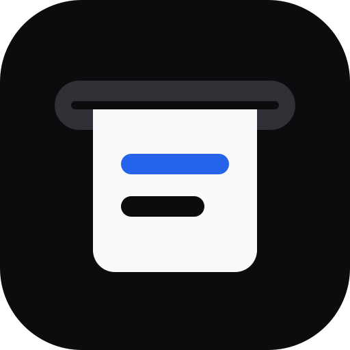
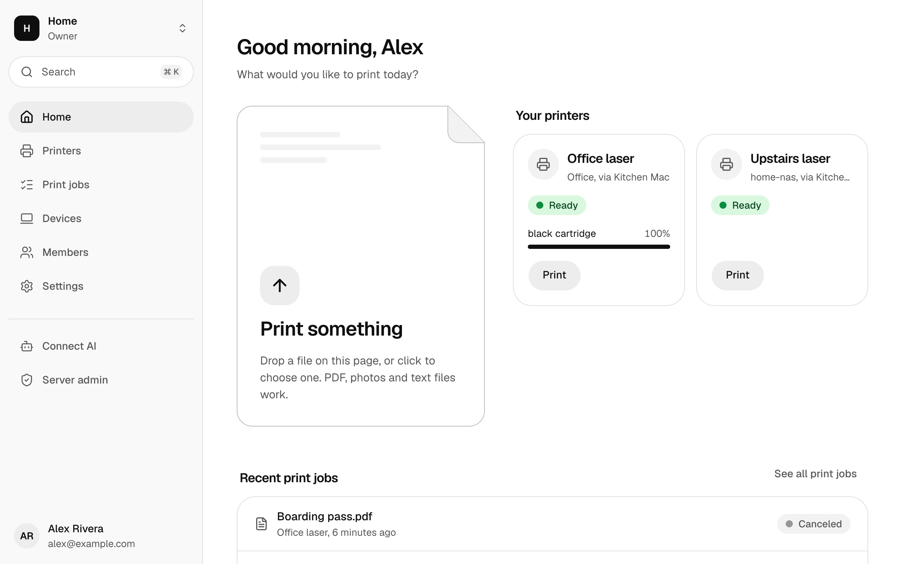
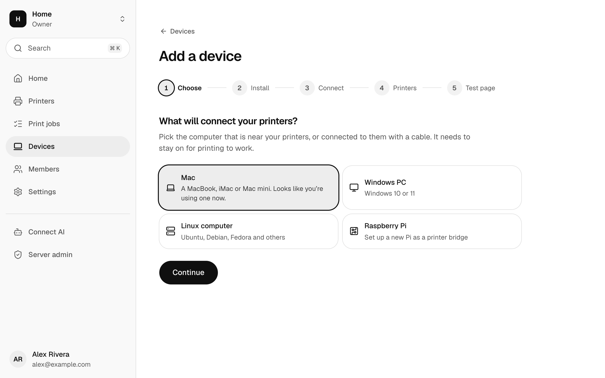
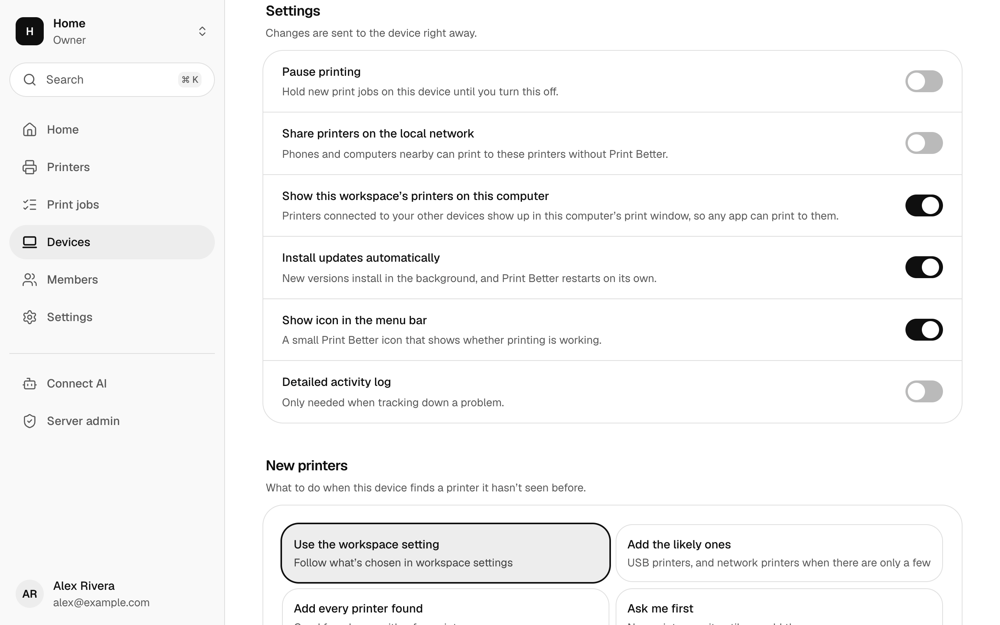
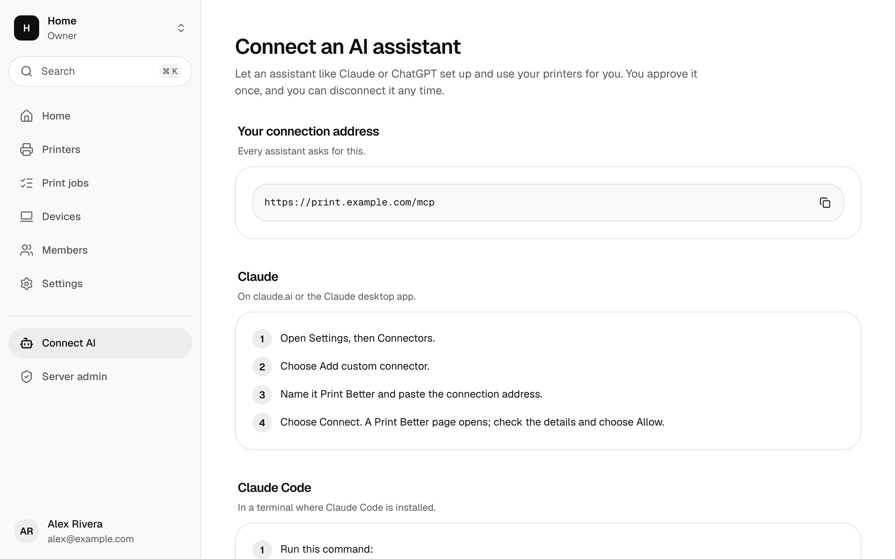
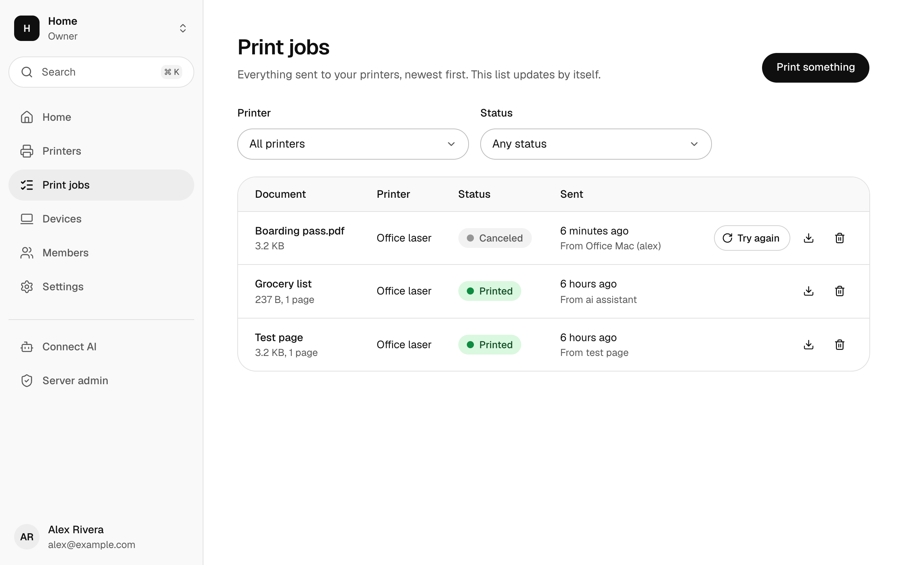

<p align="center">
  <picture>
    <source media="(prefers-color-scheme: dark)" srcset="docs/assets/print-better-logo-dark.svg">
    
  </picture>
</p>

<h1 align="center">Print Better</h1>

<p align="center">Self-hosted printing that just works. Print to the printers you already have, from anywhere.</p>

<p align="center">
  <a href="https://github.com/yannelli/print-better/releases"></a>
  <a href="LICENSE"></a>
  <a href="https://workers.cloudflare.com/"></a>
  <a href="client/"></a>
  <a href="docs/mcp.md"></a>
</p>

<p align="center">
  <picture>
    <source media="(prefers-color-scheme: dark)" srcset="docs/assets/screenshots/home-dark.png">
    
  </picture>
</p>

Print Better is a print server you run on your own Cloudflare account, plus a small program (`printbetter`) that runs on a computer next to your printers. You send a document from the web app, from any app's print window, from a script, or from an AI assistant. The client next to the printer prints it.

- **Print from anywhere.** Upload a file in the web app, call the REST API, ask Claude or ChatGPT, or send an email (optional). Jobs wait on the server while a printer's computer is off and print when it comes back.
- **Your printers in every print window.** On a Mac or Linux desktop, printers that live on your other devices show up in System Settings and in every app's Cmd+P dialog. Nothing to set up; it is on by default.
- **Finds printers on its own.** The client looks on the network (Bonjour, SNMP for older office printers), on USB, and in the computer's own printer list. You pick whether new printers are added for you or wait for your OK.
- **Works with the printers you have.** Driverless IPP and IPPS (AirPrint, IPP Everywhere), raw port 9100, LPD, USB, and the operating system's print system (CUPS, the Windows spooler). For printers that can't read PDF, the client converts pages to PWG, Apple, PCL, or PostScript raster.
- **Built to keep going.** Jobs survive restarts and network drops, retry with backoff, and switch to another route to the same printer. Printer problems (out of paper, low toner) show up in plain language.
- **Simple sign-in.** Username and password, passkeys, and optional Google or any OpenID Connect provider. Workspaces have owners, admins, and members, with invite links and recovery codes.
- **Easy device setup.** Adding a computer is one copy-paste command or one double-click on the signed macOS installer. For a Raspberry Pi, the web app writes the first-boot files for the SD card, and the Pi installs and connects on its first start.
- **A signed Mac app.** The macOS app and installer are signed with a Developer ID, notarized, and stapled, with a small menu bar icon that shows whether printing works.
- **AI assistants can do the setup.** The built-in MCP server lets Claude, ChatGPT, Claude Code, and other MCP clients do everything the web app can, with the same permissions.

## Why

Printing at home or in a small office still breaks in the same old ways. A laptop can't see the printer, a driver won't install, or someone has to ask for help to print a boarding pass. Print Better keeps the printers where they are, puts one small program next to them, and gives everyone else a simple web app and a normal print window. The client only makes outgoing connections, so you never open a port on your network.

## How it works

```text
 web app, REST API,     HTTPS    Cloudflare Worker   RPC   WorkspaceHub        WSS     printbetter      IPP, USB,
 MCP, email, Cmd+P   ────────▶   (API, web app,    ─────▶  (Durable Object)  ◀──────   client       ──────────▶ printers
                                  MCP, OAuth)                                          (daemon + tray)
                                     │
                                     ├── D1: accounts, devices, printers, jobs
                                     └── R2: documents, client downloads
```

1. You print from the web app, the API, an AI assistant, or a print window on a paired Mac or Linux desktop.
2. The Worker checks who you are and what you may do, stores the document in R2, and queues the job in D1.
3. The workspace's Durable Object sends the job over the WebSocket that the printer's client keeps open.
4. The client prints by the best route it knows and reports progress, printer status, and supply levels back.

Details: [Architecture](docs/architecture.md), [client protocol](docs/protocol.md), and [remote printers](docs/remote-printers.md).

## Quick start

You need a Cloudflare account on the **Workers Paid** plan (password hashing needs more CPU time than the Free plan gives), Node.js 22.12 or later, pnpm, `jq`, and `openssl`. To build the clients you also need a Mac with Rust 1.92 or later, `zig`, and `cargo-zigbuild`. A Developer ID is optional and only needed for signed macOS builds.

### 1. Deploy the server

```sh
git clone https://github.com/yannelli/print-better.git && cd print-better
pnpm --dir server install
pnpm --dir server exec wrangler login
scripts/deploy.sh
```

`scripts/deploy.sh` does these steps:

1. Builds the web app and deploys the Worker. Cloudflare creates the D1 database and the R2 bucket on the first deploy.
2. Applies the database migrations.
3. Creates the secrets `SETUP_TOKEN`, `APP_SECRET`, and `AUTH_PEPPER` if they are missing.
4. Prints a one-time setup link.

Back up `APP_SECRET` and `AUTH_PEPPER`. Cloudflare does not show them again. To pick a custom domain, do it before anyone registers a passkey; see [Self-hosting](docs/self-hosting.md).

### 2. Publish the client downloads

The install commands and the **Add a device** page download clients from your own R2 bucket. Publish once after the first deploy, and again for each update:

```sh
scripts/release.sh --publish remote
```

The script builds every platform on your Mac, signs and notarizes the macOS app and installer, and uploads the files. Use `--no-notarize` for a faster local check, or `--platforms "macos"` to build a subset. See [Releasing the client](docs/release.md).

### 3. Create your account and add a device

Open the setup link, create the owner account and the first workspace, and choose **Devices > Add a device**. The page walks you through 5 steps: choose, install, connect, printers, and a test page.

| Device | How it installs |
| --- | --- |
| Mac | Double-click the signed installer, or paste the one-line command. |
| Linux | `curl -fsSL https://<your-server>/install.sh \| sh -s -- --token pbe_…` |
| Windows | `$env:PB_TOKEN='pbe_…'; irm https://<your-server>/install.ps1 \| iex` |
| Raspberry Pi | The web app writes the first-boot files for the SD card in your browser, so your Wi-Fi password never reaches the server. The Pi installs and connects on its first start. |

Each command already holds a single-use pairing code. Run it again later to update the client; it keeps the pairing.

## Use it with AI assistants

The MCP server lives at `https://<your-server>/mcp`. The **Connect AI** page in the web app has the steps for each assistant.

| Client | How |
| --- | --- |
| Claude | Open Settings > Connectors, choose Add custom connector, and paste the address. Choose Allow on the Print Better page. |
| Claude Code | Run `claude mcp add --transport http print-better https://<your-server>/mcp`, then type `/mcp` to sign in. |
| ChatGPT | Turn on Developer mode, create a connector with the address, and pick OAuth. |
| Scripts and other tools | Create a personal API token under **Your account > Apps and tokens** and send it as a Bearer token. |

Things you can ask: "Set up the printer in my office", "Print this PDF on the kitchen printer, both sides", or "Why isn't my printer working?". The tools are listed in [MCP server](docs/mcp.md).

The same token works with the REST API:

```sh
curl -X POST https://<your-server>/api/workspaces/<workspace-id>/jobs \
  -H "Authorization: Bearer $PRINTBETTER_TOKEN" \
  -H "Content-Type: application/json" \
  -d '{"text":"Hello from Print Better"}'
```

Without a `printerId`, the job goes to the workspace's default printer. See [REST API](docs/api.md).

## Screenshots

| Add a device | Device settings |
| --- | --- |
|  |  |
| **Connect an AI assistant** | **Print jobs** |
|  |  |

## Docs

| Page | Contents |
| --- | --- |
| [Self-hosting](docs/self-hosting.md) | Deploy, secrets, custom domains, Google and OIDC sign-in, email, backups, and updates |
| [Releasing the client](docs/release.md) | Build targets, signing and notarization, publishing to R2, and known limits |
| [Remote printers](docs/remote-printers.md) | How printers on other devices show up in Cmd+P on Mac and Linux |
| [Client CLI](docs/cli.md) | `printbetter` commands, service install, install scripts, and Raspberry Pi first boot |
| [REST API](docs/api.md) | Every route, auth, token scopes, and errors |
| [MCP server](docs/mcp.md) | Protocol versions, OAuth 2.1, scopes, and the tool list |
| [Client protocol](docs/protocol.md) | The WebSocket messages between the server and the client |
| [Architecture](docs/architecture.md) | How the Worker, the Durable Object, D1, R2, and the client fit together |
| [Product requirements](docs/prd.md) | Goals, users, requirements, metrics, and the roadmap |
| [Research notes](docs/research/) | Printing protocols, the Rust client, Cloudflare, and MCP auth |

## Development

```sh
scripts/dev.sh                     # local D1, R2, and Durable Objects, plus the web app and Worker on http://localhost:5173
cd client
cargo run -p printbetter -- pair --server http://localhost:5173 --token pbe_…
cargo run -p printbetter -- run    # daemon and tray; status page at http://127.0.0.1:47631
```

| Command | Does |
| --- | --- |
| `pnpm --dir server check` | Type-checks the Worker and the web app |
| `pnpm --dir server test` | Runs the server and web app tests (Vitest) |
| `pnpm --dir server build` | Builds the web app and the Worker |
| `cargo clippy --workspace --all-targets` | Lints the client (run in `client/`) |
| `cargo test --workspace` | Runs the client tests (run in `client/`) |
| `scripts/release.sh --no-notarize` | Builds every client platform without waiting for Apple |

## Project layout

```text
server/             One Vite project: the React web app and the Cloudflare Worker
  worker/           API, auth, OAuth, MCP, the WorkspaceHub Durable Object, email, install scripts
  src/              The web app (React, shadcn/ui, Tailwind CSS)
  shared/           Types shared by the Worker and the web app
  migrations/       D1 schema
client/             Rust workspace
  crates/print      pb-print: discovery, IPP, conversion, print backends, LAN sharing
  crates/app        printbetter: CLI, daemon, server session, job queue, tray, service install
  packaging/        macOS app bundle, launchd, systemd, and udev files
scripts/            Deploy, local dev, cross-builds, macOS signing and notarization, publishing
docs/               The docs above, plus research notes
```

## Security

- The client only makes outgoing connections. Nothing on your network needs an open port.
- Passwords are hashed with scrypt and a server-wide pepper (`AUTH_PEPPER`). Stored secrets, such as SSO client secrets and email keys, are encrypted with `APP_SECRET`.
- API, device, and OAuth tokens are stored as hashes. OAuth uses PKCE (S256), short-lived access tokens bound to `/mcp`, and refresh tokens that rotate on every use.
- Every token has scopes (`read`, `write`, `print`), and REST and MCP share the same permission checks.
- Documents are deleted from R2 after the workspace's retention time (24 hours by default).
- Raspberry Pi first-boot files are made in your browser. Wi-Fi passwords never reach the server.
- Email to print is off by default. When it is on, mail that fails DMARC or comes from a sender who is not allowed is dropped.

Report security problems privately as described in [SECURITY.md](SECURITY.md).

## Status

Phase 1, version 0.1. These items are known limits today:

- Remote printers in the print window work on macOS and Linux. Windows support is not built yet.
- Windows builds are not signed.
- The armv6 build (Raspberry Pi Zero and Pi 1) compiles but is best effort.
- Microcontroller (ESP32) bridges and a server-side IPP endpoint are planned for a later phase.

## Contributing

Read [CONTRIBUTING.md](CONTRIBUTING.md) for setup, the commit format, and how releases work. Releases follow [Semantic Versioning](https://semver.org/); see [CHANGELOG.md](CHANGELOG.md). This project follows the [Code of Conduct](CODE_OF_CONDUCT.md).

## Maintainer

Built by [Ryan Yannelli](https://ryanyannelli.com) ([@yannelli](https://github.com/yannelli) on GitHub).

## License

[MIT](LICENSE)
